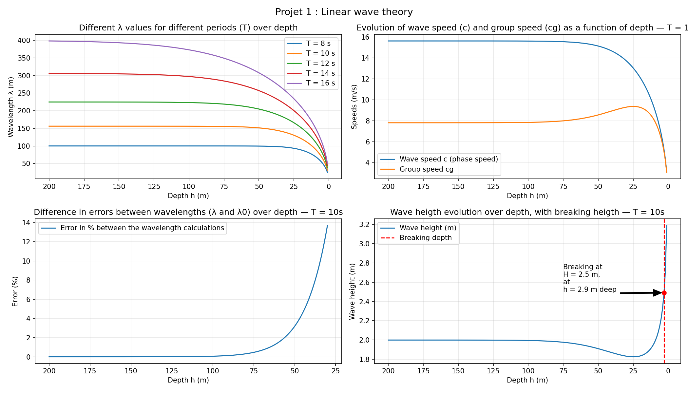
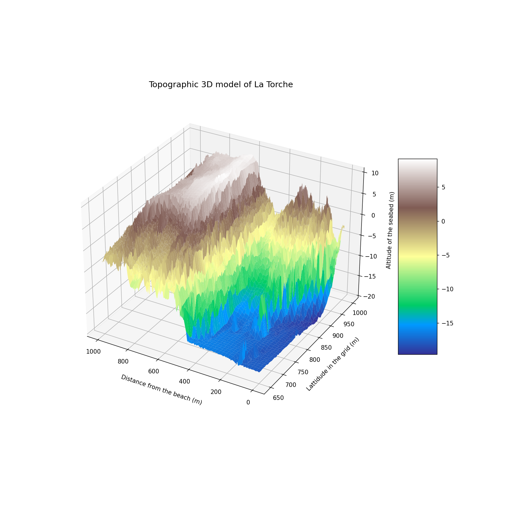

# Wave Project — Wave modeling

This is a personal physical wave modeling project aimed at deepening my knowledge in oceanography, for a potential internship application at [eCoast Marine](https://www.ecoast.co.nz), NZ.


## Context

I am a student at Polytech Lille specializing in embedded systems, after a really interesting internship at the University of Seville, where I developped an USV for eDNA collection in ports, I'm currently doing a exchange semester in the CUCEI in Guadalajara, Mexico. 
As I have some free time and love surfing, I decided to embark on this project exploring coastal wave physics to better understand this field.

PS : I did the README file in english to be able to share it, but the code itself is in french and the comments too.


## Project structure

- [x] Projet 1 — Linear wave theory (dispersion, shoaling, breaking)
- [ ] Projet 2 — Analysis of real data (CANDHIS buoy, Penmarc'h)


## Projet 1 — Linear wave theory

- **Dispersion relation** : $\omega^2 = g \cdot k \cdot \tanh(k \cdot h)$ — numerical resolution (finding $k$) using Brent's method
- **Wave properties** : wavelength $\lambda$, celerity $c$, group velocity $c_g$
- **Shoaling** : height evolution via conservation of energy ($K_s = \sqrt{c_{g0} / c_{gh}}$)
- **Breaking** : Miche criterion ($H - 0.142 * np.tanh(kh) * lam$)




## Projet 2 - Analysis of real data

This project goal is to make me use the maths I learned in the first project.

What I did : 

### Wave data
- Retrievied data from a CANDHIS buoy I've chosen (Penmarc'h buoy)


- Sorted thoses data to keep only waves coming from the West (210° - 290°)
- Plotted the amplitude, period and power of thoses waves


### Topographic data
- Retreived and sorted topographic data from the spot of my choice
- Plotted the topographic data on a 3D grid




###


## Installation

```bash
git clone https://github.com/ton-username/wave_project
cd wave_project
python -m venv .venv
.venv\Scripts\activate       # Windows
pip install -r requirements.txt
```


## Run the notebooks

```bash
jupyter lab
```

Open `notebooks/01_dispersion.ipynb`


## References

- Dean & Dalrymple — *Water Wave Mechanics for Engineers and Scientists* (1991)
- MIT 2.20 Marine Hydrodynamics — Lectures 20-21
- Vagues et houles - André TEMPERVILLE, encyclopedie-environnement.org
